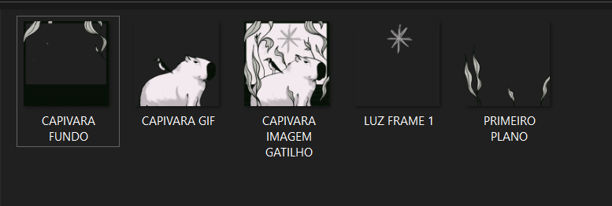
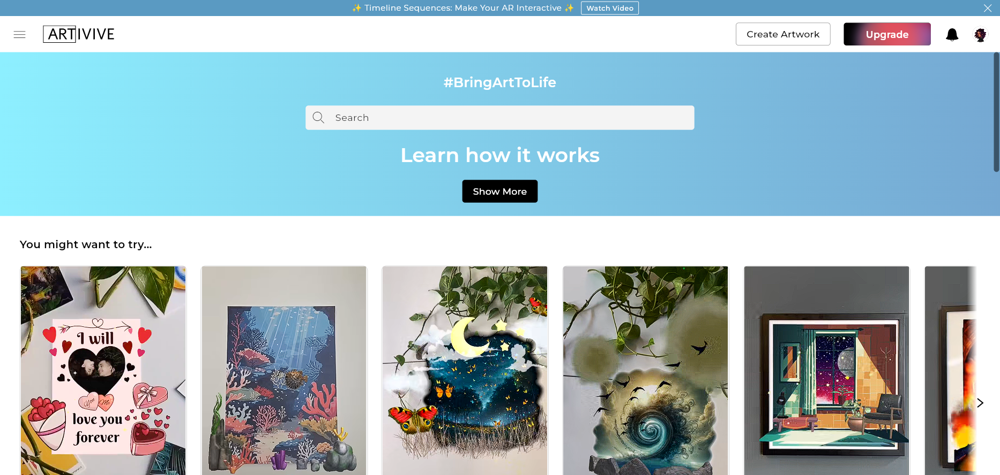
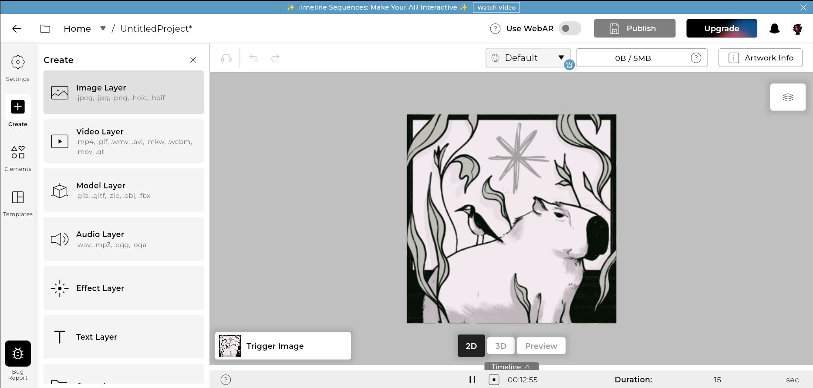
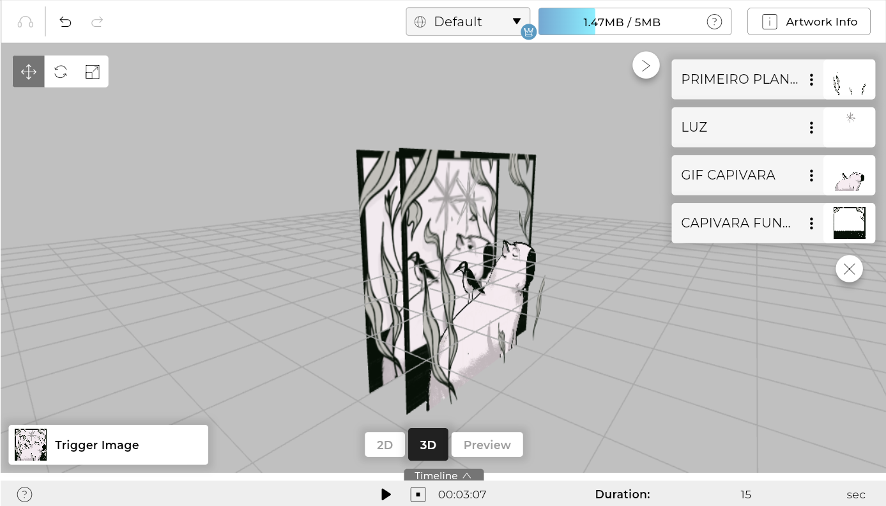
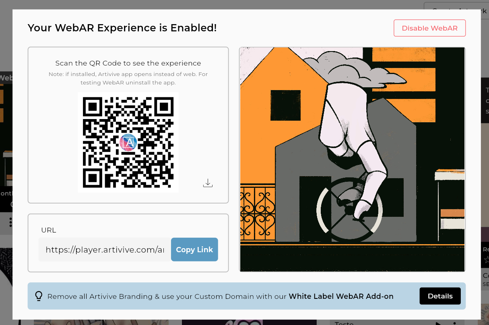

# INSTALAÇÃO INVISÍVEL: ACERVO ABERTO

Bem-vindo(a) ao repositório da pesquisa “Instalação Invisível: Arte em Realidade Aumentada”.

Este acervo faz parte do Trabalho de Conclusão de Curso (Licenciatura em Artes Visuais - IFCE) de Maria Fernanda de Araújo Lopes, com aplicações desenvolvidas por Gabriel Miranda.

O objetivo deste repositório é difundir o processo de arte digital no campo expandido. Aqui, abrimos o esqueleto do nosso processo técnico para que outros artistas, estudantes e pesquisadores possam modificar, replicar e desenvolver seus próprios experimentos em realidade aumentada (AR) de forma autônoma.

### O que você encontra aqui e como utilizar:

#### ARtist - Aplicação de Geolocalização (código aberto)
Aplicação web construída com a biblioteca AR.js. Ela permite ancorar modelos tridimensionais em coordenadas GPS reais, lendo a bússola e o giroscópio do celular direto pelo navegador.

[Clique aqui para acessar o repositório AR.js](https://github.com/render41/artist-project)

---

#### Artivive Bridge - Passo a Passo para Image Tracking

**1. Preparando arquivos**
Antes de ir para a plataforma, é importante organizar seus arquivos:
- **Imagem gatilho:** A imagem base que será exibida e lida pela plataforma.
- **Camadas:** Os ativos de sobreposição. Podem ser arquivos de vídeo (.mp4 ou .gif), modelos 3D (.glb ou .fbx) ou imagens com ou sem fundo transparente (.jpg e .png).

**2. Criando Projeto**
- Acesse o Artivive Bridge e faça o login na sua conta.

- No painel inicial, clique no botão “Create Artwork”.
- Uma tela em branco será aberta com uma janela “Add trigger image”, que significa “adicionar imagem gatilho”. Clique para adicionar a imagem ou arraste-a até a janela.

**3. Configurando o Rastreio de Imagem (image tracking)**

- No menu lateral esquerdo, selecione o tipo de camada virtual que você quer adicionar (*Image layer* - camada de imagem; *Video Layer* - camada de vídeo; *Model Layer* - camada de modelo 3D; *Effect Layer* - camada de efeitos; *Audio layer* - camada de áudio; ou *Text layer* para adicionar texto).
- Adicione os seus ativos. As camadas aparecerão sobrepostas à imagem gatilho no centro da tela. Também é possível vê-las e organizá-las na lista de camadas à direita superior.

**4. Ajuste Espacial e Eixo 3D**

- Para mexer com o eixo espacial, mude a visualização da opção 2D para 3D na barra inferior da área de trabalho. A interface vai inclinar a perspectiva exibindo uma malha tridimensional.
- Selecione cada camada virtual e ajuste-a nos eixos X (deslocamento para as laterais em relação à imagem gatilho), Y (deslocamento da altura para cima e para baixo em relação à imagem gatilho) e Z (deslocamento da profundidade, para fora ou para trás em relação à imagem gatilho).
- Utilize o botão *Preview* para checar se está tudo rodando corretamente.

**5. Ativando o WebAR**
- No menu superior, localize o modo “Use WebAR” e certifique-se de ativá-la (ela ficará colorida). Isso permitirá que a obra seja visualizada direto pelo navegador, sem precisar baixar aplicativos.
- Clique no botão “Publish” (publicar) no canto superior direito.
- A plataforma processará os dados e exibirá uma janela de confirmação informando “Your WebAR Experience is Enabled”, que significa “Sua experiência WebAR está habilitada”. Nesta janela, baixe o QR Code ou copie a URL gerada. Esse link é o que abrirá a câmera do navegador do interator para escanear a obra.

> **Dica:** Use o QR Code nos templates de sinalização disponibilizados abaixo.

---

#### Materiais Gráficos
Sinalizações desenvolvidas para exposição urbana. Contém instruções para o público e QR Codes. Você pode baixar os cartazes das intervenções criadas para esta pesquisa em .pdf, prontos para impressão, ou baixar os arquivos editáveis para customizar com sua própria arte e QR Codes.

[Clique aqui para baixar PDF](assets/pdf)

[Clique aqui para baixar modelos editáveis](LINK_DO_MODELO_EDITAVEL_AQUI)

---

Obrigada por visitar e explorar este acervo!

Em caso de dúvidas ou colaborações, sinta-se à vontade para entrar em contato pelo e-mail fehdigitalarts@gmail.com.

Para mais informações e registros, acesse: https://artist-web-pi.vercel.app.
